<picture>
  <source media="(prefers-color-scheme: dark)" srcset="assets/header-dark.svg">
  <source media="(prefers-color-scheme: light)" srcset="assets/header-light.svg">
  
</picture>

<br>

```ts
const me = {
  name:    "Wesley Souza",
  handle:  "95wesley",
  builds:  ["web apps", "local-first tools", "developer tooling"],
  writes:  ["TypeScript", "JavaScript", "Vue", "PHP", "Go", "Rust", "C#", "Python"],
  also:    ["Ruby", "Shell", "Docker"],
  values:  ["open source", "readable code", "software that runs on your own machine"],
};
```

### ◇ Building

- **findDevClean**: a developer cleanup tool. It finds caches and build artifacts, moves them to a
  quarantine you can undo, and runs as a single Go binary with an embedded web UI.
  Go · React · Vite · <a href="https://github.com/95wesley/findDevClean">repository</a> · <a href="https://github.com/95wesley/findDevClean/releases/latest">download</a>
- **chat-realtime-websocket**: real-time chat over WebSocket.
  <a href="https://github.com/95wesley/chat-realtime-websocket">repository</a>
- **municipios-brasileiros**: a dataset and tools for Brazilian municipalities.
  <a href="https://github.com/95wesley/municipios-brasileiros">repository</a>

### ◇ Toolbox

<p>
  
  
  
  
  
  
  
  
  
  
  
  
  
</p>

### ◇ Principles

- **Local first.** Data stays on your device whenever it can.
- **Undoable.** Destructive actions go through a quarantine or a dry run first.
- **Readable over clever.** If a change needs a diagram to understand, it needs a rewrite.

### ◇ Links

- Website: [bywesley.com.br](https://bywesley.com.br)

<p align="right"><sub><i>Thanks for stopping by.</i></sub></p>
